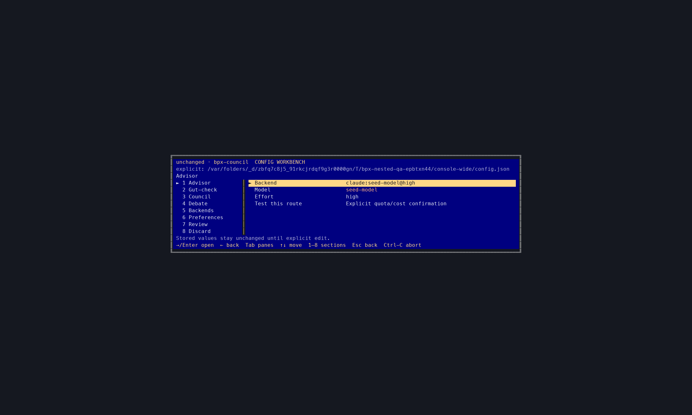
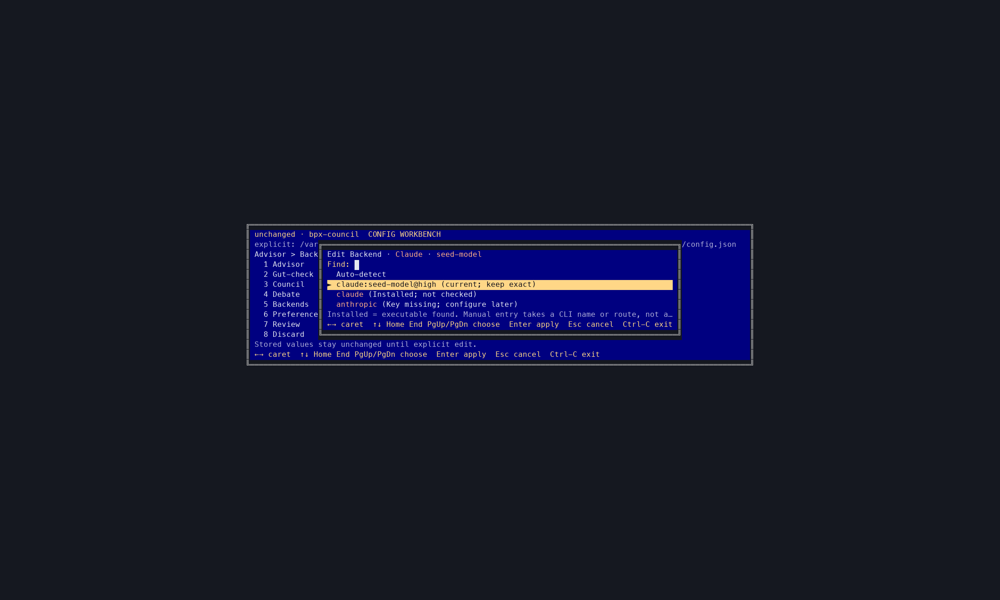
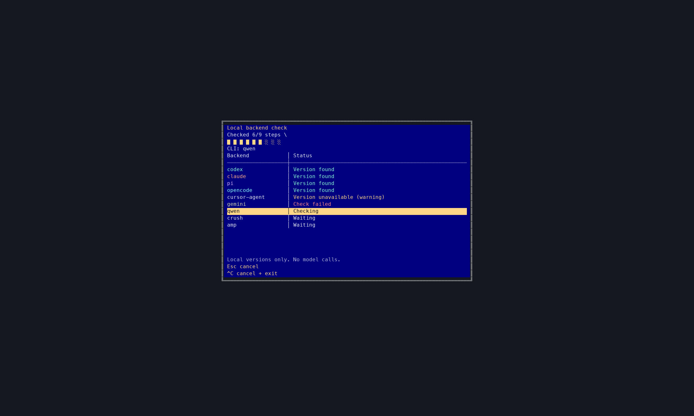

# Configuration

`bpx-council config` opens a centered DOS-style workbench built with Ink:
sections on the left, editable settings on the right, and scope, path, draft
status and keyboard hints kept visible. A bounded navy window sits on a
charcoal surround; sparse screens shrink instead of stretching across a large
terminal. Field editors, pickers, confirmations and running checks share the
same window style. Advisor, Gut-check, Council, Debate and Preferences stay
independent; choosing Solo doesn't hide the other routes.



*(Console capture from the built CLI, rendered from real terminal cells.
Backend names and prompts are synthetic fixtures; no provider accounts were
used. [Full-size image](design/console-captures/workbench.png) — more captures
in [design notes](design/console-captures/README.md).)*

```bash
bpx-council config          # interactive
bpx-council config --dry-run
bpx-council config --backend codex --model gpt-5.6-sol --mode solo --yes   # headless
```

## Moving around

Keys 1–8 jump straight into sections; Tab switches panes. Up/Down move
through sections and fields. Right enters details from the sidebar, then
opens the selected editable field; Enter also opens or edits. Left/Escape
returns one level and restores focus, then returns to the sidebar. Actions
such as Test, Generate, Accept, seating and Save require Enter, never an
arrow press. Escape from the sidebar asks before exiting; it doesn't switch
sections or discard anything. Focus is remembered when you return. Narrow
terminals show one pane at a time instead of squeezing two panes into
unreadable columns. Left/Right move the caret in both picker search and
manual entry, never switch panes. Manual fields also support Home/End,
Ctrl-A/E, Backspace, forward Delete and multi-character paste; long values
scroll with the caret.

## Drafts and dialogs

Edits stay in a draft until you confirm Save. **Review → Save** opens a
centered DOS-style dialog with **Cancel** selected, then **Save**. Back from
review keeps the draft. The exit dialog starts on **Keep editing**: dirty
drafts offer **Save & exit** and **Discard & exit**; clean drafts offer
**Exit**.

While a confirmation dialog is open, arrows select buttons without executing
them, Tab/Shift-Tab cycle them, and Home/End select the first/last button.
Enter confirms the selected button; Escape closes the dialog and restores the
exact section, pane, row and draft. Save validates both before opening its
dialog and when confirmed; invalid drafts stay editable with an error.
Discard/Exit and Ctrl-C write nothing. Ctrl-C cancels any in-flight call and
exits 130 after subprocess/request cleanup; inside a dialog with no call it
exits immediately. Opening settings doesn't rewrite or normalize your file.
Headless flags still bypass the workbench.

## Model pickers

Claude's model picker offers Sonnet, Opus and Haiku directly; no model ID
needs typing. These are Claude's supported aliases, resolved by the CLI when
it runs, not an account-specific catalog. Backend default keeps Claude's own
model choice. Saved exact model IDs remain selectable; manual entry is
optional.

Other model catalogs load only when you ask for them, with search for long
lists. Lookups run asynchronously; Escape cancels without replacing your
saved choice. Saved unavailable choices stay selectable, and manual model IDs
are always an option.



**Backend default** clears the pinned model and its effort; changing a model
clears stale effort too. Explicit Advisor route/model/effort changes also
clear the legacy `solo.thinkingLevel` fallback, so it can't silently restore
the old effort. Untouched settings keep it. Same-backend edits keep custom
arguments and timeouts. Detected binaries and catalog entries don't prove
you're logged in.

The hub preserves untouched fields and refuses rather than clobber an invalid
file. Headless `config --yes` leaves saved seats, roster, persona prompts,
gut-check settings and backend-specific options alone.

## Checking installed backends

Backends (shortcut 5) lists every supported CLI, including Missing and
Unusable entries, plus stock Anthropic API key presence. Installed means an
executable was found on PATH, not that login or a chosen model has been
tested. The backend picker shows these installation facts instead of a
blanket login warning. *Enter backend manually…* is an advanced
command/route shortcut, not an API key field and not an installer.

Choose **Check installed CLIs** to run bounded, cancellable version commands.
These checks never send a model prompt. A centered blocking dialog shows the
current CLI, completed steps, a segmented progress bar and aligned
backend/status rows. Navigation and editing stay locked until completion or
cancellation cleanup; Escape cancels, Ctrl-C cancels then exits.



Hard local-check failures are excluded from ordinary new assignments, while
saved routes remain available to keep unchanged. An unfamiliar version string
is a warning, not proof of a broken backend, and remains selectable. Version
errors, missing commands and unsupported advisor presets stay distinct. Open
a backend for its path/version. Connection receipts show the requested route
and latency and expire when that route changes; they do not mark every model
on a backend as working.

Interactive `bpx-council install` offers the same local version checks,
defaulting to No, before agent integration. Headless install, config startup
and npm postinstall do not launch these commands or make model calls. Windows
gets presence inventory but version checks remain unsupported until descendant
cancellation can be guaranteed.

Preferences is shortcut 6, Review 7 and Discard 8. Checks and their results
stay in the session; only Review → Save writes configuration.

## Testing selected routes

**Test this route** uses the unsaved route, including inherited model and
legacy Advisor effort. **Test all members** runs eligible Council seats
sequentially after one confirmation showing the call count. Blocked seats
show reasons; completed results survive cancellation and later seats are
marked not called. Escape cancels the request/process and waits for cleanup.
Tests never save config.

Results show attempted route, response status and latency. A response is not
independent proof of model identity, persona quality or general entitlement.
Results stay in this session only and are invalidated when their effective
route changes. Smoke tests send a synthetic request, not workspace files or
persona prompts; AI generation sends the focus you entered.

Workbench tests/generation support guarded Pi, tool-disabled Claude and stock
Anthropic HTTP. Basic connection tests also support Codex: a tiny synthetic
prompt, selected model/effort, private working directory, project-instruction
suppression, read-only sandbox, quota confirmation and cancellable cleanup.
Codex may still use tools; the confirmation states this, and private cwd is
not a filesystem boundary. Codex AI persona generation remains blocked under
the stricter tool-disabled rule. OpenCode, tmux, custom CLI arguments, custom
HTTP destinations/key variables and unsupported transports remain blocked here
rather than silently changing routes.

A failed exact model route is not offered again as an ordinary unchanged
assignment; changing its model/effort or testing successfully clears that
specific failure. Saved routes are never silently deleted, and one failure
does not blacklist all models on a backend. CLI actions also need Unix
process-group cancellation; Windows can use Anthropic HTTP. A conflicting
`BPX_COUNCIL_MODEL`/`ANTHROPIC_MODEL` override must be cleared before testing
a shared draft selection; independent seat pins are not replaced by it.

Project drafts edit one file, not the merged global layer. If a seat inherits
Advisor and that project file has no Advisor backend, testing is blocked
rather than guessing the global route. Test from Global settings or pin a
project Anthropic backend. Independently pinned project HTTP seats remain
testable.

## Global vs per-project

By default config is **global** (`~/.bpx-council.json`), one setup for your
whole machine. But a repo can carry its own:

```bash
bpx-council config --scope project    # writes .bpx-council.json at the repo root
```

At runtime the layers stack: **defaults → global → the repo's
`.bpx-council.json`**, with the project file overriding only the keys it sets.
So a project config of just

```json
{ "solo": { "backend": { "type": "http", "provider": "anthropic", "model": "claude-opus-4-8" } } }
```

means "this repo uses Opus, everything else stays my usual." Discovery walks
up from your working directory to the git root, so it works from any
subdirectory.

You can **commit `.bpx-council.json`** for shared mode and routes, but a repo
isn't a trusted source of executable instructions. Auto-discovered project
files can select Anthropic HTTP and its model; Council/Debate seats use
Anthropic routes or `null` to inherit Solo. They cannot choose CLI commands
(even Codex: its read-only sandbox still permits shell reads), tmux, HTTP URL
or API-key variable, SDK routes, or `sharePiAuth`. They may reorder or select
bundled Council personas, but cannot supply persona prompts or select trusted
custom personas. Project gut-check routes follow the same Anthropic-only
rule; output-token preference is allowed. An invalid file fails with its path
and key before any model call.

The full trust model — what a repo may and may not decide — is in
[Security and trust](security.md).

Need a custom command or URL? Put it in your own global config or pass an
explicit trusted `--config <path>`; either overrides/escapes project
restrictions. Don't pass a repo-controlled file explicitly as a shortcut
around this check.

Existing repo `.bpx-council.json` files with CLI/tmux routes, custom URLs, or
persona prompts now fail validation. Move those choices to your global config
or a trusted file passed with `--config`; keep the repo file within the
Anthropic-only rules above. Run `bpx-council doctor` to check routes without
paying for a call.
