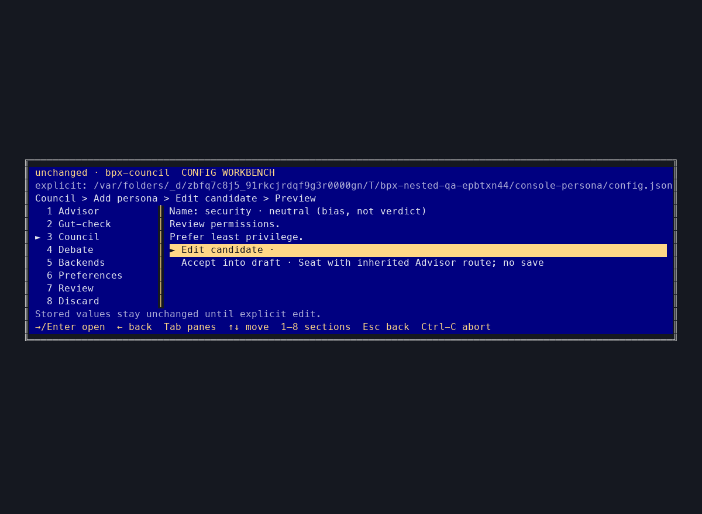

# Personas and seating

Council runs three personas: architect (for), critic (against), simplifier
(neutral). By default they all share one backend, so you get three stances
from one model. Useful and cheap, but it isn't multi-model. Assign different
backends and it is — see [Modes](../README.md#modes) for the flags, or read
on for the saved-config version.

## Saving seat assignments

Backends map to personas in roster order. Fewer specs than members is fine;
extra specs fail before any call. For each member, precedence is positional
`--backends`, then saved `council.backends` by persona name, then Solo. Each
verdict is labelled with its persona and model, so you can see who argued
what.

```json
{
  "council": {
    "backends": { "architect": "codex:gpt-5.6-sol", "critic": "anthropic:claude-opus-4-8" },
    "synthesizer": "codex:gpt-5.6-sol"
  },
  "debate": {
    "advocate": "codex:gpt-5.6-sol",
    "critic": "claude:opus",
    "synthesizer": "codex"
  }
}
```

Each seat uses its explicit flag, then its saved spec, then the shared Solo
backend. `--backend` and `--model` change that fallback, not pinned seats.
Omit a seat to inherit Solo; in a project config, use `null` to reset a seat
assigned globally. In settings, choose **Inherit Advisor** to write `null`;
Escape leaves the current choice alone.

The synthesizer can use a fourth backend. Debate's advocate, critic and
synthesizer can each have their own too:

```bash
bpx-council --mode council --backends codex,claude,opencode \
  --synthesizer codex:gpt-5.6-sol "Should we ship this?"
```

## The persona library

Council → **Manage seating** opens the persona library. Seat/unseat keeps
definitions and route assignments; Council needs 1–8 seated members. Global
and explicit trusted configs can edit a persona's prompt and stance. Editing
a bundled persona creates an explicit override; **Reset builtin prompt**
removes only that override. Existing names stay fixed, and new names cannot
overwrite another persona.

Council's default roster stays architect, critic, simplifier. To change it,
edit trusted global config (or an explicit trusted `--config` file):

```json
{
  "personas": {
    "reviewer": { "stance": "against", "systemPrompt": "Review deployment risks. Name specific failure modes." }
  },
  "council": {
    "members": ["architect", "reviewer"],
    "backends": { "reviewer": "claude" }
  },
  "gutCheck": { "backend": "anthropic:claude-opus-4-8", "maxOutputTokens": 96 }
}
```

`personas` defines or replaces named prompts (stance: `for`, `against`, or
`neutral`); definitions merge by name across trusted layers. `council.members`
is an ordered, atomic list (1–8 unique safe names). Prompts must be nonblank
and at most 8,000 characters. Define up to 16 persona entries. Project
configs can seat bundled personas but cannot author prompts.

## Adding personas

Council → **Add persona** offers manual and AI-assisted creation.

Manual candidates have a name, stance and multiline system prompt. Enter
inserts a newline in the prompt editor; Ctrl-S applies the field, not the
config file. Preview and Accept put the reviewed definition into the draft.
New personas inherit Advisor and are seated if there's room; otherwise they
remain in the library.



AI-assisted creation asks for a focus and a configured generator route.
Generate opens a quota/cost dialog with Cancel selected. A successful call
produces an editable candidate, not a saved persona. Inspect it, edit or
regenerate, then Accept into draft. Name collisions remain errors until
corrected. The generator route does not become the new persona's route. Final
Review → Save still decides what reaches disk.

## Gut check

Gut-check uses explicit `--backend` first, then `gutCheck.backend`, then Solo;
`null` resets it to Solo. `maxOutputTokens` (1–4096) sets the HTTP or SDK
output-token budget. For a CLI route, it's only a prompt request, not a hard
limit or billing cap. Findings are never cut after generation. The settings
hub edits gut-check routes and output tokens.
